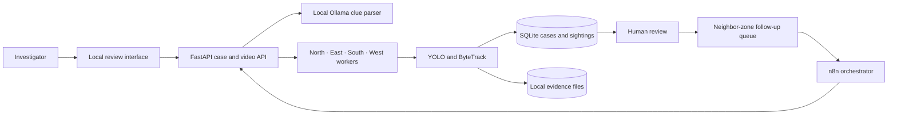

# CCTV Investigation Agent

A local, human-reviewed video search prototype for organizing CCTV footage by camera direction and searching it with natural-language clues. The system analyzes registered clips, records timestamped candidates, and presents evidence for reviewer assessment.

Use synthetic or publicly licensed footage for demonstrations. This project is a decision-support prototype; it does not identify people or determine guilt or enforcement outcomes.

## Capabilities

- Accept text clues and optional voice transcription. Ollama parses target type, broad color, visible-attribute notes, approximate time, and starting direction.
- Organize footage across four directions: North, East, South, and West.
- Analyze locally registered clips with YOLO and ByteTrack for people, bicycles, cars, motorcycles, buses, and trucks.
- Store candidate class, camera, recording timestamp, video offset, detector confidence, review status, and evidence hash.
- Review video candidates in a browser interface and record `confirmed_candidate`, `not_relevant`, or `needs_more_review` decisions.
- Queue neighboring-zone work only after a person candidate is confirmed by a reviewer. Jobs wait until a matching local clip is registered.
- Verify source clips, derived sighting hashes, and the hash-chained audit log through the integrity endpoint.

## Architecture



FastAPI runs on Windows and stores evidence locally. The n8n workflow dispatches registered zone clips to the API. Ollama parses clues locally; YOLO processes video on CPU or CUDA, depending on the installed PyTorch runtime and device setting. No cloud vision service is required by the processing path.

## Requirements

- Windows 10/11 and PowerShell
- Python 3.14 for the tested CUDA/audio setup
- Ollama with `llama3.2:latest` (or a compatible local model)
- Docker Desktop with n8n for workflow orchestration
- NVIDIA GPU and a compatible CUDA PyTorch build for GPU inference; CPU mode is also supported

## Windows setup

1. Install Ollama, start it, and make sure the selected model is available:

   ```powershell
   ollama pull llama3.2:latest
   ollama list
   ```

2. In the project directory, copy `.env.example` to `.env`. Set unique `REVIEW_USERNAME` and `REVIEW_PASSWORD` values before opening the review interface.

3. Install the CPU/video environment and start the backend:

   ```powershell
   ./run_backend_video.ps1
   ```

   The launcher binds to `127.0.0.1` by default. To force CPU inference, pass `-Device cpu`.

4. Open `http://localhost:8000/health` and confirm the service and video-runtime status. Open `http://localhost:8000/` for the authenticated review interface.

5. For RTX 5050 CUDA inference, run `./setup_gpu.ps1` once, then start the GPU launcher:

   ```powershell
   ./setup_gpu.ps1
   ./run_backend_gpu.ps1
   ```

   Confirm that `/health` reports CUDA readiness. The GPU setup script expects Python 3.14 at `C:\Python314`.

6. Voice transcription is optional. Run `./setup_audio.ps1` and then `./run_backend_gpu.ps1`. The first use downloads the selected Faster-Whisper model; later transcription runs locally. Configure `WHISPER_MODEL` and `WHISPER_DEVICE` in `.env` as needed.

### Connecting Docker n8n to Windows

The included workflow calls the host API at `host.docker.internal:8000`. Docker access requires a non-loopback listener; enable it explicitly:

```powershell
./run_backend_gpu.ps1 -BindAddress 0.0.0.0
```

This listens on all host interfaces. Before enabling it, configure Windows Firewall to allow port 8000 only from the Docker network and deny other networks. Do not expose the API to the public internet. Without this option, the backend remains loopback-only.

## Importing the n8n workflow

1. In n8n, import `n8n/CCTV-Investigation-Orchestrator-Import.json` as a new workflow. Keep existing workflows intact.
2. Start the FastAPI backend and verify its health before running n8n.
3. The manual trigger path runs the four-direction planner. Only clips registered for the case and direction are analyzed; missing clips remain in a waiting state.
4. The form trigger provides a case-intake path. The scheduled trigger polls ready follow-up jobs and dispatches work for clips attached to reviewer-approved neighboring-zone searches.
5. Upload synthetic or public clips through the review interface. Provide the case ID, jurisdiction, camera ID, and actual recording timestamp with timezone. A newly uploaded clip can make a waiting follow-up ready for analysis.
6. Review candidates in the browser. A confirmed person candidate can queue a neighboring-zone search; the reviewer makes the final decision.

The workflow JSON targets `host.docker.internal:8000`. Test this address from the Docker host after configuring the Windows listener and firewall.

## Search and review behavior

1. Enter or dictate a clue and review the parsed text and attributes.
2. The planner assigns registered clips to the North, East, South, and West workers.
3. YOLO detects supported object classes and tracks them within each clip. A track ID is local to that clip and is not a cross-camera identity.
4. The API persists timestamped candidate records and associates each with its source clip and evidence hash.
5. A reviewer inspects the video segment and records a review decision. Only a human-confirmed person candidate can start neighboring-zone work.

## API

| Endpoint | Purpose |
|---|---|
| `POST /api/v1/investigations/start` | Create or start a case and parse its clue with local Ollama |
| `POST /api/v1/videos` | Register a local video with case, zone, camera, and recording-time metadata |
| `POST /api/v1/zones/analyze` | Dispatch a batch of registered clips to directional workers |
| `POST /api/v1/zone/analyze` | Analyze one registered clip |
| `GET /api/v1/sightings` | List timestamped candidates for review |
| `GET /api/v1/followups/ready` | List follow-up jobs with matching registered clips |
| `POST /api/v1/followups/{id}/analyze` | Analyze a ready neighboring-zone clip |
| `GET /api/v1/integrity` | Validate evidence hashes and the audit chain |

Reviewer-facing routes use HTTP Basic authentication configured with `REVIEW_USERNAME` and `REVIEW_PASSWORD`. Keep the backend on a trusted local network.

## Validation status

- The backend contract suite contains 31 tests; it passed 31/31 on the local Python 3.14 runtime. Coverage includes zone validation, batch dispatch, reviewer gating, clue parsing behavior, persistence, integrity checks, upload/review routes, and launcher configuration. Audio transcription is mocked in the contract tests.
- A live four-direction n8n run analyzed four synthetic clips on the RTX 5050 and persisted eight actual detector candidates. The integrity endpoint validated the audit chain, evidence files, and sighting hashes.
- Local Ollama clue parsing, synthetic GPU follow-up analysis, and a scheduled n8n follow-up execution were exercised with synthetic data.
- A synthetic H.264 clip passed API upload and file delivery, decoded as 12 frames at 640×360 and 5 fps, and produced two timestamped CUDA candidates. Browser playback of that exact clip was not verified in the cloud browser environment.

## Limitations

- No facial recognition, face matching, reference-photo identity matching, license-plate OCR, or identity claims.
- Scars, tattoos, distinctive marks, bags, and similar free-text attributes are reviewer notes; they are not machine-verified. Person matching uses only broad visible class and color cues.
- A vehicle or person track is not a confirmed sighting. Reviewers must inspect each candidate and its source footage.
- Repeated synthetic frames validate routing and inference, not realistic multi-camera matching or field accuracy.
- The review interface was visually checked with synthetic candidates. Exact H.264 browser playback and the current Windows Docker-to-host connection should be validated on the target workstation.
- Configure real case camera locations, jurisdictions, recording timezones, retention, and footage provenance before using non-demo material.

## Tests

Create an isolated environment, install the backend and video requirements, then run the contract suite from the repository root:

```powershell
python -m venv .venv
.\.venv\Scripts\Activate.ps1
python -m pip install -r requirements.txt -r requirements-video.txt
python -m unittest discover -s tests -v
```

Evidence files and the SQLite database are stored locally under `data/` by default. These files are excluded from version control.
