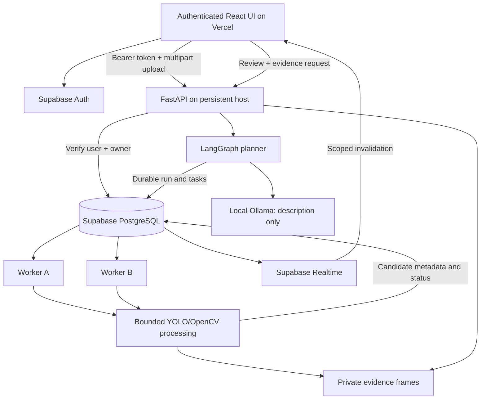

# 02 — Technical Requirements Document (TRD)

**CCTV-AI-Agent | MVP v1 | 26 November 2026**  
Read the PRD and comparison PDF first. This is a target technical contract, not an assertion of existing capabilities.

## 1. Locked stack and dependencies

| Layer | Use | Existing foundation / required changes |
|---|---|---|
| Frontend | React 19, TypeScript, Vite, existing React Router and TanStack Query, existing Tailwind/CSS | `frontend/react`; add `@supabase/supabase-js`; retain lockfile and compatible installed versions; no Next.js migration. |
| Auth | Supabase Auth, email/password, invite-only by default | Replace `setCredentials`, in-memory `logged`, Basic dependencies; validate bearer JWT with verified provider identity on backend. |
| API | Python FastAPI, Pydantic, Uvicorn, httpx | `app/main.py`, `app/schemas.py`; reuse routes, introduce owner-safe response DTOs. |
| Planner | LangGraph with existing Ollama structured clue parsing | `app/orchestration.py`, `app/ollama_client.py`; local model only sees description, validates supported object clues, no images or external data. |
| Analysis | Existing YOLO11n weights, Ultralytics, OpenCV, ByteTrack | `app/video_analysis.py`, `requirements-video.txt`; retain within-video object processing, filter supported categories, no identity/plate matching. |
| Worker | Existing durable PostgreSQL queue and Python worker processes | `app/worker.py`; bounded pool, claims, leases, heartbeat, fenced writes and aggregation. |
| Persistence | Supabase PostgreSQL via psycopg; existing `app/db.py` | Extend migrations additively, no alternate production DB, keep SQLite for unit tests only. |
| Live updates | Supabase Realtime Postgres Changes | Subscribe only to scoped case/job/sighting/review changes; invalidate queries; reconnect refetch. |
| Media | Private Supabase Storage for durable review frames; backend durable private volume for raw footage by default | Storage object keys, hashes, authorized signed URLs, retention; raw Storage optional by owner approval. |
| Hosting | Vercel frontend; persistent local GPU or cloud backend | Not Vercel serverless for inference/worker. HTTPS host selected by owner. |
| Testing | Existing Python tests, Playwright browser test, add auth/DB/concurrency/end-to-end tests | `tests/`, `frontend/react/tests/browser.cjs`; no replacing genuine inference with mocks in acceptance demo. |

Supabase and Vercel plans, storage/egress and compute costs are not verified. No additional paid AI API is required by the design. Ollama and model weights run on owner-selected hardware; check dependencies, licenses and limits before public release. Preserve working pinned versions and add only necessary packages. Do not introduce Redis, Celery, Kubernetes, n8n or a second database for the MVP.

## 2. System boundaries and data flow

Browser never connects to the privileged PostgreSQL connection, service-role credentials or worker internals. Backend uses trusted owner identity for all changes; RLS is an independent browser read/subscription boundary. The database is the source of truth, Realtime is a notification channel, not the durable queue or sole read path. Backend and workers share access to private media; raw volume must be durable and shared if on separate machines. No direct browser upload of unverified video objects in this design.

## 3. Existing code and change map

| Path | Current behavior | Target |
|---|---|---|
| `frontend/build.mjs`, `frontend/package.json`, `frontend/vercel.json` | Build copies `app/static/review.html` | Build React with Vite; choose Vercel root `frontend/react`, configure React build/dist and SPA fallback in the effective project root; archive old build only after replacement. |
| `frontend/react/src/main.tsx`, `pages/Login.tsx`, `api.ts` | In-memory login + Basic Auth | Auth provider, route guard, bearer API client, logout/cache purge. |
| `pages/Create.tsx` | Internal ID/zone/neighbor configuration | Simple create form and upload list. |
| `pages/Dashboard.tsx`, `pages/Workspace.tsx` | Existing cases, map, review, progress polling | Owner-safe history and real job workspace; omit legacy map, camera registry and reviewer name input. |
| `app/main.py` | Existing routes, Basic/CORS-linked access, uploads, direct analysis, sightings | One protected MVP API; owner checks; normalized errors and response filtering; no direct bypass analysis routes. |
| `app/orchestration.py` | Parse/select/create/followups then ends | Parse supported clue, persist it, snapshot only ready uploaded recordings, queue once, return run. Remove follow-up node from MVP path. |
| `app/worker.py` | One sequential worker loop, lease recovery | Unique worker process IDs, safe multi-worker claims, renew leases, fenced persistence, bounded retry and aggregation. |
| `app/video_analysis.py`, `app/ingestion.py` | Local YOLO/ByteTrack and media handling | Validate input, stable candidate provenance, timestamp uncertainty, durable private frames. |
| `app/db.py`, `migrations/postgresql/001..003*.sql` | Local/PG support and no browser policies | Forward-only migration to owner-safe schema and Realtime; preserve existing IDs and records. |
| `n8n/`, `app/onvif_nvr.py`, `app/static/` | Legacy workflows and integrations | Keep inactive/archive after validation; do not expose insecure legacy endpoints in deployed MVP. |

## 4. Runtime contracts

- One official analysis entry: `POST /api/v1/cases/{case_id}/plan` (existing path). Reuse `POST /api/v1/cases` for draft creation, not legacy `/investigations/start` which starts prematurely. Disable unsupported direct zone/recording/followup/n8n/RTSP endpoints in deployed mode; not merely hide UI. Restrict global integrity/audit/internal endpoints to local operator access or disable them publicly.
- Server accepts case description and optional title; generates case ID and internal zone `upload-batch`, neighbors empty, source label per video generated when omitted. No fabricated location or capture time; if unknown use nullable recording time and relative offset. No external source URL inputs.
- Upload sequentially or with small bounded client concurrency. Stream and cap bytes, reject invalid extension/content/decode or invalid duration, clean partial files. Use server-generated file IDs and never trust user paths. Persist ready video and recording atomically after successful validation. Use stable per-file idempotency key scoped to case. Return sanitized metadata, not host paths.
- Planner accepts stable `Idempotency-Key`. Lock owned case; validate ready video IDs; reject empty/unsupported clue; persist parsed clue. Prevent second active/terminal run under MVP one-run-per-case rule. Same key returns existing state. Avoid holding DB transaction over LLM or inference: create durable planning reservation, perform parse with timeout, then transactionally queue all jobs or mark planning failure. Recovery for stale planning reservation; retry failed planning with same key (no jobs existed) or expose explicit reset only when safe. Uploads frozen when planning starts.
- Worker claims atomically on PostgreSQL (e.g. row lock `FOR UPDATE SKIP LOCKED` or guarded atomic update), sets actual worker ID + lease token. Heartbeat updates lease by token; lost lease means abort/discard staged outputs. Reuse queue retry policy max 3 attempts for transient failures; mark unsupported/corrupt permanently failed. Persist findings and job terminal status consistently, unique candidate key and upsert for repeated attempts. Aggregate status from persisted jobs; recover process crashes. Do not rely on memory-only tasks or browser session.
- Agent means a logical delegated processing worker executing a job. Multiple jobs alone do not demonstrate concurrent inference. Start with one model process on constrained hardware; verify two independent worker processes on controlled fixtures; increase actual concurrency only after measuring RAM/VRAM and latency. A single GPU may serialize inference; disclose actual behavior. Real progress counts use persisted jobs, not timers; candidates may arrive after individual job completion.
- Realtime: publish only necessary safe tables/columns, RLS authenticated owner read; filter by current case ID where supported, subscribe/unsubscribe on case/session change. On subscribe/reconnect, invalidate/refetch authoritative API; periodic low-rate polling fallback while disconnected. No browser mutation of findings/jobs. Avoid raw audit payload, lease tokens and local paths in published data; see schema document.
- Evidence: privately store original frame and SHA-256, reference original file hash, relative seconds, detection confidence and attributes. No manufactured match probability; distinguish heuristic match result from detector score. No match is legitimate. Review via API, derive reviewer from verified token and append event in same transaction as status update. Do not trigger cross-zone followups or person tracking on accept.

## 5. API quality requirements

See `05_Backend_Schema.md` for endpoint payloads and ownership. Preserve existing paths where practical; update frontend and tests together when contract changes. All API errors use consistent safe shape `{error:{code,message}, request_id}` (or documented compatible `detail` during migration); no exception traces, private paths, tokens or raw credentials. HTTP 401 missing/invalid token, 404 inaccessible case or resource, 409 state/idempotency conflict, 413 size, 415 format, 422 validation, 503 unavailable runtime. `GET /health` may expose only liveness publicly; detailed dependency health restricted to owner/operator. Validate JWT signature, issuer, audience, expiry and sub using Supabase-supported verification/JWKS or server-side Auth user endpoint; fail closed on unavailable verification, allow key rotation. Never simply decode token or use client-supplied user ID. CORS explicit frontend origins independent of auth. HTTPS in production.

## 6. Environment contract (names, never values)

| Scope | Variable | Meaning |
|---|---|---|
| Frontend | `VITE_API_BASE_URL` | HTTPS API origin; existing name |
| Frontend | `VITE_SUPABASE_URL`, `VITE_SUPABASE_PUBLISHABLE_KEY` | Public project URL/key; proposed new names |
| Backend | `DATABASE_URL` | Supabase PG server connection; mandatory outside test |
| Backend | `SUPABASE_URL`, `SUPABASE_PUBLISHABLE_KEY` | Provider identity verification settings; proposed |
| Backend | `SUPABASE_SERVICE_ROLE_KEY` | Server-only privileged Storage operations; optional if alternate restricted credentials are used |
| Backend | `CORS_ALLOWED_ORIGINS` | Explicit allowed UI origins |
| Backend | `APP_DATA_DIR`, `HF_HOME`, `FFPROBE_PATH` | Existing data/model/media tools |
| Backend | `OLLAMA_BASE_URL`, `OLLAMA_MODEL` | Existing local LLM runtime/model |
| Backend | `YOLO_MODEL`, `YOLO_DEVICE`, `YOLO_CONFIDENCE` | Existing inference config; benchmark and validate |
| Backend | `MAX_UPLOAD_MB` | Existing size limit; must be compatible with hosting limits; demo start small |
| Worker | `CCTV_JOB_LEASE_SECONDS` | Existing lease duration; renew well before expiry |
| Worker | `CCTV_WORKER_ID`, `CCTV_WORKER_COUNT` | Proposed stable unique process identity / launcher pool bound; count is not existing direct batch setting |
| Backend | `CCTV_EVIDENCE_BUCKET` | Proposed private bucket name; default `cctv-evidence` |
| Backend | `CCTV_ENV` | Proposed explicit `development`, `test`, `production` with DB/auth guard |

`VIDEO_WORKER_CONCURRENCY` currently controls legacy direct batch, not the LangGraph worker pool. `REVIEW_USERNAME`/`REVIEW_PASSWORD` must not be needed for MVP production. Optional legacy audio/ONVIF/RTSP vars not part of the deployment. Add placeholders to `.env.example` and `frontend/react/.env.example` (or document actual effective Vite path) during implementation; don't overwrite real `.env`. Never place DB URL/service credentials in `VITE_*`. No actual secrets supplied. Validate configuration at startup; use test-only isolated fixtures.

## 7. Deployment and repository conventions

Keep repository root `CCTV-AI-Agent/`. Extend `app/`, `frontend/react/src/`, `migrations/postgresql/`, `tests/`, `scripts/` and `docs/`. New migration filenames sequential (`004_...sql` onward); no editing applied migrations. Python snake_case, TypeScript typed API contracts, PascalCase components, stable IDs, UTC ISO timestamps for new API responses. Keep docs in `docs/source-of-truth/` unchanged unless owner approves a spec revision. Use focused commits after each accepted phase, no automatic push. ZIP has no `.git` metadata; owner must connect to correct existing repo/history, not overwrite remote or initialize an unrelated repo without approval.

Vercel root preference `frontend/react`, install `npm ci`, build `npm run build`, output `dist`, configure SPA deep-link fallback, frontend env and Auth redirects. Backend on persistent host with authorized HTTPS API origin and bounded compute. Verify from deployed browser, not only local host. Never proxy large inference requests through Vercel. Start production backend and workers under supervised persistent process manager selected by owner; document start/stop and health commands. Keep migrations and Supabase configuration in version-controlled SQL/documentation; backup before applying to existing data.
