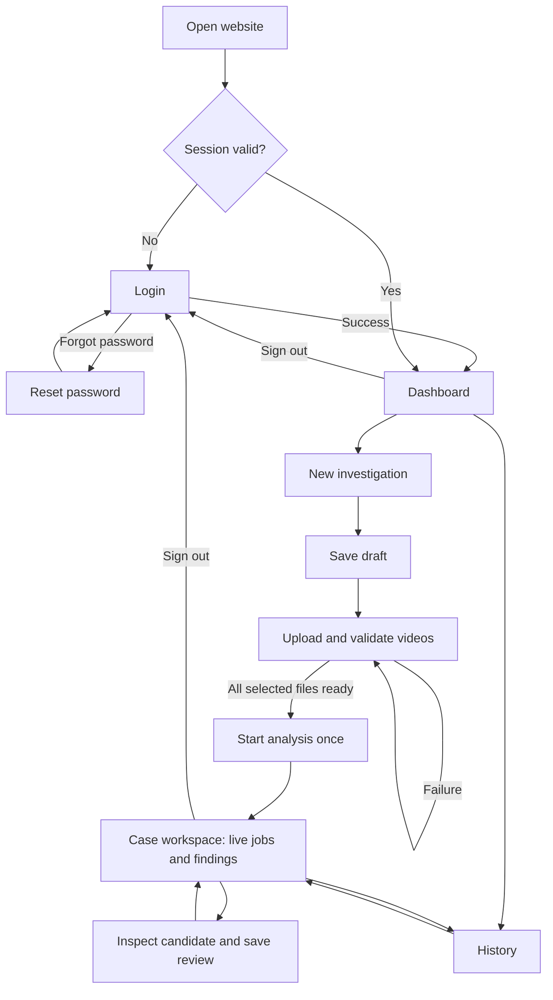

# 03 — App Flow: Navigation & User Journey

**CCTV-AI-Agent | MVP v1 | 26 November 2026**  
All flows below are target behavior. Keep the application small: one authenticated shell, one creation flow, one case workspace and saved history.

## 1. Routes and navigation

| Route | Access | Purpose and primary action |
|---|---|---|
| `/` | Either | Wait for session restore; redirect by role/verification status (`/dashboard`, `/admin`, `/onboarding`, `/verification-status`, or `/login`). |
| `/login` | Public | Email/password sign-in, forgot password, and link to officer self-registration (`/register`). |
| `/register` | Public | Police officer account signup (Step 1), email verification instructions, and resend verification. |
| `/onboarding` | Verified unapproved officer | Multi-step professional profile (Step 2) and synthetic/redacted supporting document upload (Step 3) + submit for review. |
| `/verification-status` | Verified non-approved officer | Display submission date, status (`draft`, `pending_review`, `additional_info_required`, `rejected`, `suspended`), review notes/reasons, and authorized resubmission. |
| `/reset-password` | Public / valid recovery session | Request reset email or set password on recovery link; generic confirmation to avoid account enumeration. |
| `/auth/callback` | Auth flow | Finish valid email confirmation/recovery callback; redirect only to allowed local paths. |
| `/dashboard` | Approved officer | Counts, recent and active cases; New investigation, View history. |
| `/investigations/new` | Approved officer | Describe case, create draft, upload multiple files, Start Investigation. Existing `/create` redirects here. |
| `/cases/:id` | Approved officer, owner | Overview, footage, actual agent activity, findings/review; draft can resume upload. |
| `/history` | Approved officer | Owner's cases and filter by status/review; click case to reopen its workspace. |
| `/account` | Authenticated | Account information, district/designation summary, and Sign Out. |
| `/admin` | Active District Administrator | District overview metrics, pending/approved/rejected/suspended officer queues, verification workspace, and administrative history. |
| Any other path | Either | Accessible not-found screen; return to appropriate home/login. |

Desktop sidebar: Overview, New investigation, History; bottom account menu with email and Sign out. No unrelated settings page, map or registry. Mobile: compact header/drawer with same navigation. Breadcrumb/back link on case/new pages. Browser back and deep-link reload work via SPA fallback. Do not make separate duplicate review/history screens; case findings and review history are in workspace. Preserve valid requested return path after login; never allow external redirect URLs.

## 2. Navigation map

## 3. Journey A — Authentication

1. App initializes Supabase client and restores session before requesting data. Show neutral loading screen; do not flash protected content or login.
2. New invited account follows provider invite link, sets password as required; regular login takes email/password and shows field-level validation. Do not expose invite or admin provisioning functionality publicly.
3. Login pending disables submit; on success navigate to valid requested local route or dashboard. Incorrect login stays on form with generic safe error. Network failure provides retry.
4. Forgot password opens reset request; display generic confirmation. Recovery callback validates session then lets user set new password. Expired/invalid link offers restart. Logout clears session, query cache, signed media URLs, subscriptions and local case state; redirects to login. Backend still enforces authorization for every request. On token refresh failure, clear state and redirect; authenticated jobs continue independently.

## 4. Journey B — New investigation and batch upload

1. Dashboard → New investigation. Form includes optional title, required description (supported visible object/vehicle only), authorisation checkbox. Example: “Find a blue bicycle in these staged clips.” Show limits and allowed categories. Do not require JSON, initial zone, GPS, camera ID or incident time.
2. Select or drag multiple files. Before network upload, list file names, sizes, previews if decodable, optional source label and capture time. If unknown label use generated source label; unknown capture time stays unknown. Remove local files freely before upload. Selecting files never silently starts analysis.
3. Save draft / Upload selected videos creates case once with server-generated ID. After creation use `/cases/:id` with draft state. Each file uploads with stable per-file key. Show local → uploading (bytes if available) → validating → ready or failed; cancel stops transfer, retry retains key, successful files remain. Recover list from API after reload; reselect unuploaded local files if lost. Never mark interrupted upload as ready. A removed ready file is deleted/unregistered through owner-authorized API before start; require confirmation and cleanup. No removal while starting/running.
4. Start button enabled only with valid description, authorisation, >=1 ready file, no unresolved failed/in-flight items (user may explicitly remove failed selections), no active or completed run. Client sends stable key and exact ready video IDs. Lock uploads/description on start. Display planning pending; server returns run, redirect/focus activity in workspace. Double-click/reload uses same key; request ambiguity resolved by fetching progress, not starting another run.
5. Planner error (e.g. Ollama unavailable/unsupported query): show actionable message, preserve draft and videos; safe retry only if no jobs created. A case with any existing jobs cannot be restarted wholesale in MVP. To rerun different inputs, create a new case manually. No hidden auto-analysis or mock fallback.

## 5. Journey C — Processing, findings, review and history

Workspace header shows title/description, status, ready file count, finished/total jobs and candidate count. Tabs or anchors: Activity, Footage, Findings. Agent cards show real claimed worker ID, job status, source label, errors; unclaimed tasks are queued, not running. Overall progress = terminal jobs / total jobs (includes failed; separate success/failure counts). Indeterminate during planning or when total unknown. No countdown without measured basis.

- Initial load fetches case, video list, progress and sightings. Subscribe to scoped Realtime events; invalidate affected queries and refetch; reconcile after connection and reconnect. Show “Live updates” or “Reconnecting / refreshing periodically” based on actual subscription status. Browser closure doesn't cancel processing.
- Candidate cards appear as results persist; default sort by recent detection/offset, filter by pending/accepted/rejected, source and class. Use actual frame and source metadata. Selecting card opens details drawer with larger frame, relative offset, recorded time only if known, confidence label, match rationale/limitations, integrity metadata if useful and prior review decisions. Optional video playback only if raw file retained. Missing media displays explicit unavailable state, not replacement stock image.
- Accept relevance / Reject opens confirm dialog with optional note and clear statement that it is a human relevance decision. Mutation sends decision, note and idempotency key; verified user comes from server. Disable while saving; only display saved after response. On success refresh card and review history. If already reviewed, support explicit revised decision with new history event, never overwrite past review. Cancel closes dialog without changing data.
- Terminal outcomes: completed (all jobs succeeded; possibly zero candidates), partial (some succeeded, some failed), failed (all failed or planning failed). “No candidate clues detected in the processed footage” is not proof of absence. Keep results from completed jobs even if others failed. Failed task shows safe reason and retry state; no full re-run button. Automatically retry transient errors only; terminal failure remains visible.
- History is a server-backed case list with status, date, file/finding counts and review count. Select case opens same workspace at saved state, even after logout/login or backend restart. Search/filter history by own case title or status; paginate when needed. No cross-account global searches.

## 6. State and error matrix

| Situation | Interface behavior / recovery |
|---|---|
| Initial loading | Skeleton with accessible status; no fictitious counts or sample data. |
| Empty dashboard/history | “No investigations yet” + create CTA. |
| No files | Upload prompt; Start disabled. |
| Unsupported, too large, corrupted file | Per-file explanation, remove or choose valid replacement; backend remains authoritative. |
| Upload interrupted / stale draft | Recover server ready list; show failed or unknown state, retry same key, reselect local files. |
| Backend inaccessible | Banner + retry; do not clear saved history or claim processing complete. |
| Auth lost | Sign-in redirect, clear local secrets/cache, preserve server-side jobs. |
| Case not found or not owned | Same neutral 404 message; back to history; no owner leakage. |
| Planner unavailable | Keep draft, actionable retry after backend recovery; no jobs created or clearly show reserved planning state. |
| Worker stalled / retrying | Real persisted status, retry count; no fake agent animation. |
| Realtime unavailable | Reconnect, fetch latest state, polling fallback, visible connection label. |
| No findings while running | “Waiting for candidate findings”; terminal zero matches gets different message. |
| Evidence missing | Candidate metadata still shown; error and retry; never invent preview. |
| Review save fails | Keep existing decision, retain draft note, retry same operation key. |
| Mobile/small display | Stack form/cards, drawer fits viewport, all actions keyboard/touch accessible. |

## 7. Navigation and UI acceptance

Test direct protected URL while logged out, recovery, valid callback, rejected external return URL, browser back/forward, refresh on each route, draft recovery, batch failure/retry, double start, live update/reconnect, review success/failure, history reopening and logout. Verify two-account separation in API, Realtime and media, not just hidden navigation. Each route must work with real server state; no static demo cards in production.
