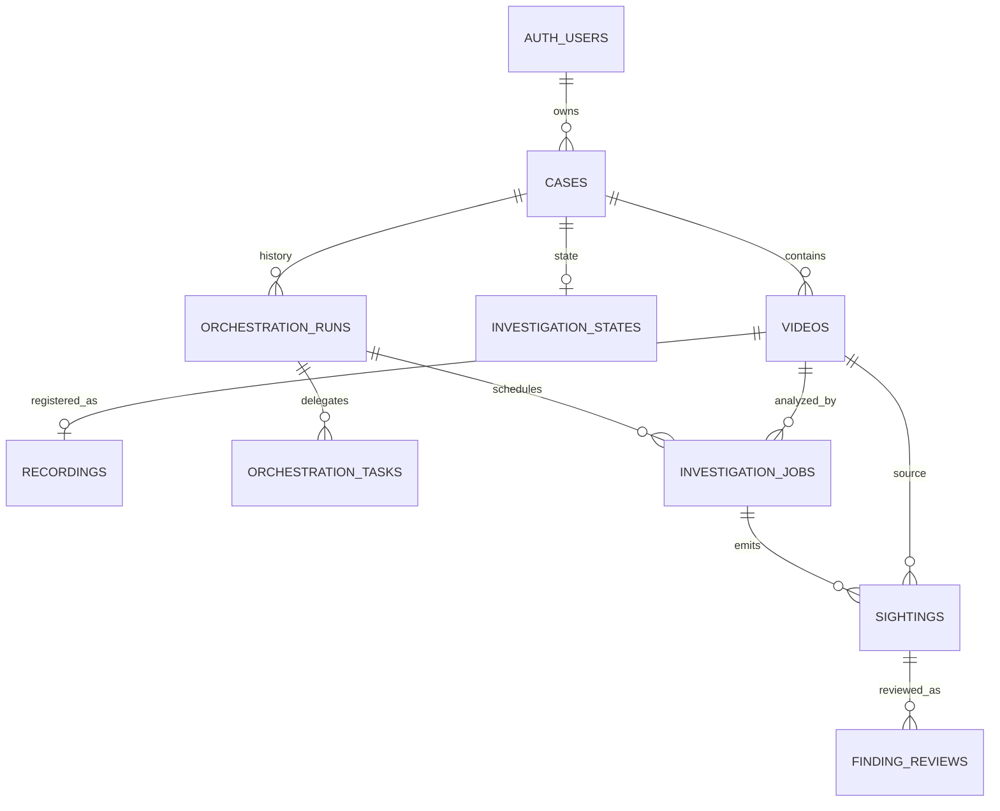

# 05 — Backend Schema: Data Model & Auth Architecture

**CCTV-AI-Agent | MVP v1 | 26 November 2026**  
This is a migration design and interface contract, not an executed migration. The baseline is `migrations/postgresql/001_initial.sql`, `002_job_leases.sql`, `003_orchestration_registry.sql` and `app/db.py` from the supplied ZIP. Inspect actual live schema and backup before any production change. Preserve identifiers and existing data; do not reset databases or assume deployed migrations.

## 1. Existing baseline (all tables)

Existing PostgreSQL IDs are TEXT, not UUID, except audit sequence and migration version. Preserve them for compatibility. Existing timestamps are TEXT ISO strings; do not silently cast legacy records. New temporal fields use TIMESTAMPTZ; normalize output to UTC. PK = primary key; FK = foreign key; NN = NOT NULL. Existing JSON is serialized TEXT. The list below describes actual migration columns; some runtime schema initialization may also exist in `app/db.py` and must be reconciled before new migrations.

| Table | Existing columns and types |
|---|---|
| `cases` | `case_id TEXT PK`, `description TEXT NN`, `initial_zone TEXT NN`, `neighbors_json TEXT NN default '{}'`, `clues_json TEXT`, `created_at TEXT NN` |
| `videos` | `video_source_id TEXT PK`, `case_id TEXT FK cases NN`, `jurisdiction TEXT NN`, `camera_id TEXT NN`, `original_name TEXT NN`, `file_path TEXT NN`, `recorded_at TEXT NN`, `sha256 TEXT NN`, `byte_size INTEGER NN`, `duration_seconds DOUBLE PRECISION NN default 0`, `created_at TEXT NN` |
| `sightings` | `id TEXT PK`, `case_id TEXT FK cases NN`, `worker_id TEXT NN`, `jurisdiction TEXT NN`, `camera_id TEXT NN`, `video_source_id TEXT FK videos NN`, `occurred_at TEXT NN`, `video_offset_seconds DOUBLE PRECISION NN`, `track_id INTEGER`, `vehicle_type TEXT NN`, `vehicle_color TEXT`, `subject_type TEXT NN default 'vehicle'`, `visual_attributes_json TEXT NN default '[]'`, `integrity_version INTEGER NN default 1`, `clue_json TEXT`, `frame_path TEXT`, `frame_sha256 TEXT`, `detector_confidence DOUBLE PRECISION NN`, `clue_match_score DOUBLE PRECISION`, `evidence_sha256 TEXT NN`, `review_status TEXT NN default 'pending'`, `reviewer TEXT`, `review_note TEXT`, `created_at TEXT NN` |
| `recordings` | `id TEXT PK`, `case_id TEXT FK cases NN`, `camera_id TEXT NN`, `jurisdiction TEXT NN`, `source_type TEXT NN`, `video_source_id TEXT FK videos`, `source_uri TEXT`, `recorded_at TEXT`, `status TEXT NN`, `created_at TEXT NN` |
| `investigation_jobs` | `id TEXT PK`, `case_id TEXT FK cases NN`, `jurisdiction TEXT NN`, `video_source_id TEXT FK videos`, `worker_id TEXT NN`, `status TEXT NN`, `error_detail TEXT`, `created_at TEXT NN`, `updated_at TEXT NN`, `attempts INTEGER NN default 0`, `lease_token TEXT`, `lease_expires_at TEXT`, `next_run_at TEXT`, `request_json TEXT` |
| `investigation_states` | `case_id TEXT PK FK cases`, `status TEXT NN`, `updated_at TEXT NN` |
| `orchestration_runs` | `id TEXT PK`, `case_id TEXT FK cases NN`, `state_json TEXT NN`, `created_at TEXT NN`, `updated_at TEXT NN` |
| `orchestration_tasks` | `run_id TEXT FK orchestration_runs NN`, `video_source_id TEXT NN`, `job_id TEXT FK investigation_jobs NN`, composite PK (`run_id`,`video_source_id`) |
| `video_metadata` | `video_source_id TEXT PK FK videos`, `metadata_json TEXT NN` |
| `audit_log` | `id BIGSERIAL PK`, `event_type TEXT NN`, `payload_json TEXT NN`, `prev_hash TEXT NN`, `entry_hash TEXT NN`, `created_at TEXT NN` |
| `cameras` (legacy) | `camera_id TEXT PK`, `jurisdiction TEXT NN`, `name TEXT NN`, `latitude DOUBLE PRECISION`, `longitude DOUBLE PRECISION`, `source_type TEXT NN`, `source_uri TEXT`, `created_at TEXT NN` |
| `followups` (legacy) | `id TEXT PK`, `case_id TEXT FK cases NN`, `source_sighting_id TEXT FK sightings NN`, `target_zone TEXT NN`, `window_start TEXT NN`, `window_end TEXT NN`, `video_source_id TEXT FK videos`, `status TEXT NN default 'pending'`, `created_at TEXT NN`, unique (`source_sighting_id`,`target_zone`) |
| `schema_migrations` | `version INTEGER PK`, `applied_at TEXT NN` |

Existing indexes: `videos_zone_time(case_id,jurisdiction,recorded_at)`, `sightings_case_time(case_id,occurred_at)`. Existing migrations enable RLS but create no browser policies. `auth.users` is provider-owned; do not create a password table. No separate `profiles` table required for MVP (use verified account email/display name only if needed).

## 2. Target additions and migration rules

Add forward-only migration(s) starting at 004; adjust SQLite test schema to match compatible application contracts without pretending SQLite validates PG RLS. Do not rename every legacy column. A migration must be versioned and tested against fresh and populated copies, with safe rollback/recovery instructions. Never use broad permissive RLS or assign old records to the first user.

| Table | Target delta / type | Constraint and semantics |
|---|---|---|
| `cases` | `owner_id UUID`, `title TEXT`, `authorized_at TIMESTAMPTZ`, `updated_at TIMESTAMPTZ` | FK `owner_id → auth.users(id)` restrict deletion; owner set exclusively from verified JWT. Nullable for quarantined legacy rows until explicit approved mapping; require non-null for newly created rows. Description limited to supported object/vehicle query. Server-generated case ID, internal zone `upload-batch`, `neighbors_json='{}'`. |
| `videos` | `upload_key TEXT`, `source_label TEXT`, `storage_kind TEXT`, `storage_key TEXT`, `media_status TEXT` | Unique (`case_id`,`upload_key`) for new uploads; `storage_kind` private durable local or private object storage; media status ready/unavailable; `file_path` server-only, never sent to browser. Relax `recorded_at` NOT NULL for unknown capture time; preserve existing known timestamps. Optional capture metadata is not assumed accurate. |
| `recordings` | Reuse existing columns | One ready upload recording per video for MVP; unique non-null `video_source_id` after duplicate audit. Source type `upload` only; `source_uri` not accepted. |
| `orchestration_runs` | `start_key TEXT`, `status TEXT`, `input_video_ids JSONB`, `error_code TEXT`, `started_at TIMESTAMPTZ`, `finished_at TIMESTAMPTZ` | New run status planning/queued/running/completed/partial/failed. Enforce one MVP run per case for new runs (quarantine/handle legacy multiple runs before constraint); key scoped to case. Input set immutable after reservation; persist validated parsed clue in `cases.clues_json` and relevant run state. |
| `orchestration_tasks` | Reuse existing keys; add unique `job_id`; add FK for `video_source_id` after validating legacy rows | One job per source per run. Check source and job belong to same case as run. |
| `investigation_jobs` | `run_id TEXT FK orchestration_runs`, `heartbeat_at TIMESTAMPTZ`, `started_at TIMESTAMPTZ`, `finished_at TIMESTAMPTZ` | New jobs always have run/source; unique (`run_id`,`video_source_id`); queued/running/retrying/completed/failed. worker ID actual claimer; placeholder empty/unassigned before claim. Lease token internal, fenced on all writes. Retain existing lease/retry columns and normalize comparisons in SQL. |
| `investigation_states` | Reuse status + updated_at | Canonical case UI status: draft/planning/queued/running/completed/partial/failed. Existing `open` maps to draft only if no work; reconcile old states based on persisted jobs. No user-writable arbitrary status API. |
| `sightings` | `job_id TEXT FK investigation_jobs`, `candidate_key TEXT`, `frame_storage_key TEXT`, `reviewer_user_id UUID FK auth.users(id)`, `reviewed_at TIMESTAMPTZ` | Unique (`job_id`,`candidate_key`) on new rows. Candidate key deterministic from stable job/source, analysis version, class and stable sampled frame/track identifiers; test retries. Store source video hash/offset via FK, frame hash; relax `occurred_at` NOT NULL when recorded time unknown, never substitute upload time. `review_status` values pending/confirmed_candidate/not_relevant. UI labels Pending/Accepted/Rejected. |
| `finding_reviews` (new) | `id UUID PK`, `sighting_id TEXT FK sightings NN`, `case_id TEXT FK cases NN`, `reviewer_user_id UUID FK auth.users(id) NN`, `decision TEXT NN`, `note TEXT`, `request_key TEXT NN`, `created_at TIMESTAMPTZ NN default now()` | Append-only event, decision confirmed_candidate/not_relevant, unique (`sighting_id`,`request_key`); verify case consistency; transaction updates sighting + inserts event + existing audit entry. Do not invent reviewer ID for old history. |
| `audit_log` | Keep existing chain | Server-only, redact sensitive payloads from outward APIs. Preserve integrity verification semantics; lock chain append if multiple workers; test concurrent audit writes. No browser grants. |

Legacy camera/followup tables and legacy media records remain in database but inaccessible via deployed MVP; do not run auto-followups. `video_metadata` remains server-only, optional existing metadata. `schema_migrations` internal only. Backfill owner and review fields only with explicit known owner mapping. Existing unknown timestamps remain unknown; avoid overwriting evidence or rehashing historical records without versioned provenance. Add checks and unique indexes only after auditing conflicts; partial indexes for new populated fields may be needed. Avoid cascades that silently destroy evidence; any approved deletion must explicitly coordinate metadata and media cleanup. No account deletion feature in MVP.

## 3. Relationships and query/index design

Logical MVP limits new cases to one run and one job per source. Preserve legacy relationships. Enforce same-case relationship across videos, jobs, recordings, tasks and sightings via composite unique/FK constraints where feasible plus server transaction checks; no trust in client-supplied IDs. Add indexes for `cases(owner_id,created_at)`, `videos(case_id)`, `recordings(case_id,video_source_id)`, `orchestration_runs(case_id)`, `investigation_jobs(status,next_run_at)`, `investigation_jobs(case_id,run_id,status)`, `sightings(case_id,review_status,created_at)`, `finding_reviews(sighting_id,created_at)` and `finding_reviews(case_id)` plus uniqueness above. Ensure timestamp ordering works for legacy TEXT values; use normalized values or migrate after inspection. Query pagination stable by timestamp and ID. Check query plans on fixture data, not premature extra indexes.

## 4. Auth, roles and RLS

Roles: anonymous (sign-in only, no data), authenticated owner (own investigations only), trusted backend/worker (server-only processing under restricted credentials), project operator (out-of-band admin in Supabase, not app UI). No browser admin role or client role elevation. Auth uses Supabase access JWT and verified `sub`; never accept reviewer/owner from request. Backend authorization must check every read/write/media route even when its DB role bypasses RLS. Return same 404 for inaccessible and absent resource. Reject legacy Basic bypass and independently enforce explicit CORS. Never expose privileged DB role, service-role key, filesystem paths, source URIs, lease tokens or raw worker request/error fields.

RLS policy design: owner predicate `cases.owner_id = auth.uid()` for case; related records through verified case relationship. Enable RLS, revoke anon grants, grant only necessary authenticated safe columns/read rights. Browser has no insert/update/delete policy for core records; writes through verified FastAPI. Internal tables (`audit_log`, `schema_migrations`, `cameras`, `followups`, `video_metadata`, `orchestration_runs`, `orchestration_tasks`) no direct browser reads. Realtime published events must not leak server-only columns: preferred implementation is a minimal new `case_events` table with sanitized content rather than granting table-wide access to raw jobs or sightings. This resolves the TRD's safe-publication requirement; use this table as the single Realtime channel for MVP.

`case_events` proposed columns: `id BIGINT GENERATED ALWAYS AS IDENTITY PK`, `case_id TEXT FK cases NN`, `kind TEXT NN` (case_changed, video_changed, job_changed, finding_changed, review_changed), `created_at TIMESTAMPTZ NN DEFAULT now()`. Index (`case_id`,`id`); RLS authenticated SELECT if case owner matches `auth.uid()`, no browser write, no anon read. Publish only INSERT changes (configure Postgres Changes publication for this table), no sensitive payload. Insert event transactionally whenever case/video/job/finding/review mutation commits. Client filters `case_id=eq.<id>` for case workspace, owner-scoped subscription for history/dashboard. On event invalidate relevant query keys; refresh all after subscription/reconnect; polling fallback. Keep event retention bounded; events are ephemeral notifications, not review history. Do not rely on DELETE events for authorization. If Supabase publication/permissions differ, verify against actual project and document approved adjustment. Test account A/B access to API, RLS reads, Realtime and media directly.

Sensitive data: credentials only in server env/secret store; TLS for external connections, use provider-managed encrypted storage and disk encryption for durable local volume. Do not log descriptions, raw frames, JWTs, signed URLs or passwords. No need for biometric templates, plate text or precise location fields in MVP. Review notes may be sensitive; minimize and owner-scope. SHA-256 is integrity metadata, not encryption.

## 5. Media storage

Private bucket `cctv-evidence` (proposed), keys `owner_uuid/case_id/video_source_id/sighting_id/frame.jpg`; generate server-side, do not trust filenames as keys. Upload frame before committing reference; track staged uploads and clean orphaned objects safely on failed DB commit. Use immutable frame content/hash per finding; on retry reuse verified object or create safe version and clean orphan. Backend authorizes ownership before returning short-lived signed URL or streaming media. Bucket must not be public; block client arbitrary writes, listing and access to other owners. Signed URL expiry recommended 5 minutes; possession grants temporary access, avoid logs and revoke UI references on logout. Verify storage and metadata after restart. Default raw footage location: durable private backend volume with generated keys, access via owner-authorized API; optional private raw bucket path `owner_uuid/case_id/video_source_id/original.ext` only after approval. Upload cap/retention/quotas documented and tested; no automatic data destruction until owner approves policy. If raw footage expires, retain authorized frame/metadata according to policy and show “Source footage no longer available”.

## 6. MVP API contract (proposed extensions of existing endpoints)

All protected endpoints require `Authorization: Bearer <access_token>`. JSON uses safe DTOs; stable string IDs. Status/error conventions in TRD. Preserve relevant existing field names to minimize churn; never return internal DB rows wholesale. List endpoints owner-scoped and paginated (default 25, cap 100; stable sorting). Exact implementation can add safe metadata fields but must not change the flow without owner approval.

| Method/path | Input | Output / rules |
|---|---|---|
| `GET /health` | None | Minimal liveness, no sensitive dependency config. |
| `POST /api/v1/cases` | `{title?,description,authorized:true}` | 201 `{case_id,title,description,status:'draft',created_at}`; server sets owner + internal zone. Proposed create idempotency key. |
| `GET /api/v1/cases` | pagination, optional status | `{items,total?,next_cursor?}`; owner cases with actual derived counts; adapt legacy array consumers. |
| `GET /api/v1/cases/{case_id}` | ID | Case DTO incl. status, parsed supported clue, counts and dates; 404 if not owned. |
| `POST /api/v1/videos` | multipart `case_id,file,source_label?,recorded_at?`; `Idempotency-Key` header | 201 ready video DTO `{video_source_id,case_id,original_name,source_label,recorded_at,byte_size,duration_seconds,sha256,status}`. Server generates internal camera label/zone. Duplicate same key returns prior ready result; different content/key conflict. |
| `GET /api/v1/videos?case_id=...` | case ID | Owner-safe video metadata, not local file path. |
| `DELETE /api/v1/videos/{video_source_id}` | ID | Proposed draft-only remove; authorize, transactionally unregister ready video, coordinate cleanup; 409 after start. |
| `POST /api/v1/cases/{case_id}/plan` | `{video_source_ids:[...]}`, `Idempotency-Key` | 202 `{run_id,case_id,status,job_count}` or existing run on same key; 409 conflict, 422 no valid videos/unsupported clue. Planning reservation durable; may queue after parsing in request, never await inference. |
| `GET /api/v1/cases/{case_id}/progress` | case ID | `{case_id,run_id?,status,total_jobs,completed_jobs,failed_jobs,terminal_jobs,sighting_count,jobs:[{id,video_source_id,worker_id,status,attempts,error_code?,updated_at}]}`. Do not return tokens, request JSON, lease details. |
| `GET /api/v1/sightings?case_id=...` | optional review_status, source, pagination | Actual candidate rows: id, case/source/job IDs, label/color/attrs, offset, known capture time, detector confidence, match explanation, frame availability, review state. Not global or unfiltered person search. |
| `GET /api/v1/sightings/{id}/frame` | ID | Owner-authorized frame stream or signed URL response (choose one and update frontend consistently; stream existing path preferred for compatibility). |
| `GET /api/v1/videos/{video_source_id}/file` | ID | Optional playback if retained; authorize; prefer range-capable media, otherwise explicit unavailable. |
| `POST /api/v1/sightings/{id}/review` | `{decision:'confirmed_candidate' or 'not_relevant',note?}`, `Idempotency-Key` | Verified reviewer, append event and update current state atomically. No `reviewer` request field. No followup side effects. |
| `GET /api/v1/sightings/{id}/reviews` | ID | Owner-safe chronological review events incl. decision, reviewer ID/display, note, created time. |

No public writes to `case_events`, sightings, jobs, arbitrary status, camera or legacy analysis endpoints. External webhooks not needed; transaction event insertion is the event mechanism. Use safe backend DTOs consistently in existing React `types.ts` and test client. Candidate review does not alter the job's terminal status; case completion is processing completion, not confirmation of guilt or identity.

## 7. Status rules and test assertions

Draft: no active run. Planning: reserved run, no ready jobs yet. Queued: jobs exist, none started. Running: any active job or work remaining after execution begins. Terminal: all jobs completed = completed; mixture completed/failed = partial; all failed = failed; planning failure with no jobs = failed (safe planning retry only). Reject zero-job success. Retry states not terminal. Derive counts from current run and persist aggregate transactionally with job update, repair on restart. Review states independent. Persist candidate and review history even when other job fails. Verify migration on populated copy, owner backfill quarantine, constraints, RLS isolation, duplicate starts/uploads/reviews, expired worker fencing, no duplicated candidates, known/unknown timestamp handling, private media access and integrity after restart. Validate actual Supabase project in staging before deployment; no live verification claimed here.
